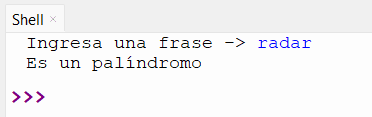

# Programación 1

Este repositorio contiene los programas desarrollados durante la materia de Programación 1. Su propósito es reunir los ejercicios realizados durante el curso y documentar el funcionamiento de cada uno.

## Programas incluidos

### Juego del gato
Juego para dos participantes con un tablero de 3 por 3.

### Juego Blackjack
Juego para un solo participante contra la banca, en el que debes superar a la banca sin pasarte de 21.

### Invertir cadena
Invierte la cadena de texto proporcionada por el usuario.

### Palíndromos
Detecta si la cadena proporcionada es un palíndromo o no.

### Factorial recursivo
Calcula el factorial de un número utilizando recursividad.

## Requisitos

- Tener instalado Python 3.
- Contar con un editor de código, como Visual Studio Code.

## Cómo ejecutar los programas

1. Abrir la carpeta del repositorio en Visual Studio Code.
2. Abrir una terminal.
3. Ubicar en la carpeta donde se encuentra el programa.
4. Ejecutar el archivo utilizando el siguiente comando:

```bash
python nombre_del_programa.py
```

**Nota:** Sustituir `nombre_del_programa.py` por el nombre real del archivo a ejecutar.

## Ejemplo de funcionamiento


```text
Ingresa una palabra: radar

La palabra es un palíndromo.
```



## Autor

Luis Gálvez
